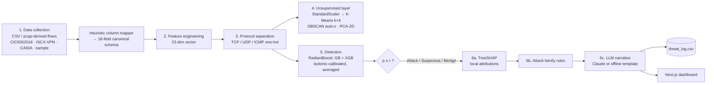
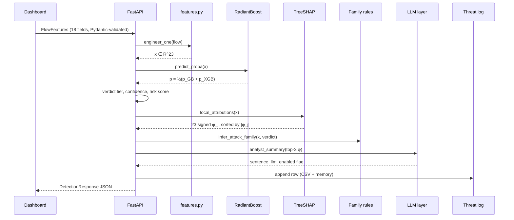

# NetSentry: An Explainable, Calibrated, and Narrated Machine-Learning Pipeline for Flow-Based Network Intrusion Detection

**Detailed Project Report — with Journal and Conference Paper Preparation Material**

| | |
|---|---|
| **Authors** | Ayush Gupta (23BCE0157), Kartikay Chauhan (24BCE0689) |
| **Course** | Computer Networks — Final-Year Project (Fall) |
| **Guide / Supervisor** | _[to be filled]_ |
| **Institution** | _[to be filled]_ |
| **Report date** | 28 October 2026 |
| **Model artifact evaluated** | `backend/artifacts/radiant_boost.joblib`, trained 2026-09-09 13:39 UTC |
| **Code** | `backend/` (FastAPI + Python ML pipeline), `frontend/` (Next.js dashboard) |

> **How to read this document.** Sections 1–14 are the full technical project report. Section 15 is a
> publication kit: positioning, venue options, the extra experiments a reviewer will demand, ready-to-adapt
> abstracts and paper outlines for both a **conference** and a **journal** version, and the mandatory
> declarations. Section 16 holds the references. All numbers in this report were either read directly from
> `backend/artifacts/*.json` or re-computed from the saved model on the exact seeded test split
> (Section 9.1 explains how); nothing is estimated.

---

## Table of Contents

1. [Abstract](#1-abstract)
2. [Introduction](#2-introduction)
3. [Background and Related Work](#3-background-and-related-work)
4. [System Architecture](#4-system-architecture)
5. [Data: Profiles, Canonical Schema, and Generators](#5-data-profiles-canonical-schema-and-generators)
6. [Feature Engineering](#6-feature-engineering)
7. [Methodology](#7-methodology)
8. [Implementation](#8-implementation)
9. [Experimental Setup](#9-experimental-setup)
10. [Results](#10-results)
11. [Discussion](#11-discussion)
12. [Engineering Lessons (Defects Found and Fixed)](#12-engineering-lessons-defects-found-and-fixed)
13. [Threats to Validity, Limitations, and Ethics](#13-threats-to-validity-limitations-and-ethics)
14. [Future Work and Conclusion](#14-future-work-and-conclusion)
15. [Publication Kit (Conference and Journal)](#15-publication-kit-conference-and-journal)
16. [References](#16-references)
17. [Appendices](#17-appendices)

---

## 1. Abstract

Network intrusion detection in practice still leans on two families of tools: interactive packet analyzers
such as Wireshark, which depend on a human applying filters and recognizing patterns, and network security
monitors such as Zeek, which emit structured flow logs but flag traffic through hand-written, signature-style
scripts. Neither produces a *learned*, *calibrated* probability of maliciousness, and neither explains *why* a
given flow was flagged. Machine-learning intrusion detection systems (ML-IDS) in the research literature
address the first gap but rarely the second, and are seldom delivered as running systems.

**NetSentry** is an end-to-end, flow-based ML-IDS that closes this loop. Raw flow records from heterogeneous
sources are normalized onto one canonical schema by a heuristic column mapper, transformed into a fixed
23-dimensional feature vector, explored without labels by K-Means and a self-tuning DBSCAN, and scored by
**RadiantBoost**, an isotonic-calibrated ensemble of Gradient Boosting and XGBoost whose decision threshold is
selected on a validation set against an operating-point constraint (TPR ≥ 95 %, FPR ≤ 2 %). Every verdict is
accompanied by exact per-flow SHAP attributions (TreeSHAP), a rule-based attack-family label, and a one-sentence
analyst narrative generated by a large language model (Anthropic Claude) with a deterministic offline
fallback. The system ships as a FastAPI service with 11 REST endpoints, a six-page Next.js dashboard, an
auditable CSV threat log, and a 19-test automated suite.

On a CICIDS2018-schema evaluation profile (6,000 flows, 33.2 % malicious, 3.5 % injected label noise),
RadiantBoost reaches **97.58 % accuracy** (95 % bootstrap CI 96.67–98.42 %), **ROC-AUC 0.971**, **precision
98.9 %**, **recall 93.7 %**, an FPR of **0.50 %**, and an expected calibration error of **0.005**, at a median
single-flow latency of 12.6 ms (≈ 50,000 flows/s batched). We show that every residual test error is
accounted for by the injected label noise, so model comparisons on this profile are saturated. A cross-profile
transfer test exposes the expected distribution-shift failure (ROC-AUC 0.541 on an ISCX-VPN-schema tunnelled
traffic task; a 25.1 % flag rate on CAIDA-schema backbone traffic carrying ~6 % anomalies). We also quantify
an under-reported fidelity gap: the tree explained by SHAP agrees with the served calibrated ensemble at a
Spearman correlation of only 0.874.

**Keywords:** network intrusion detection; flow-based traffic analysis; explainable AI (XAI); SHAP; gradient
boosting; XGBoost; probability calibration; large language models; security operations; distribution shift.

> ⚠️ **Data caveat (must be stated in any publication).** The three benchmark datasets are gated behind
> data-sharing agreements and are not yet present (`backend/data_raw/*` is empty). All results above were
> obtained on **schema-faithful synthetic profiles** produced by `backend/app/data/synthetic.py`. The pipeline
> automatically switches to real data when CSVs are dropped in. Section 15.4 lists the exact experiments to
> re-run on real data before submission.

---

## 2. Introduction

### 2.1 Motivation

Security Operations Centre (SOC) analysts face three compounding problems:

1. **Volume.** Enterprise links carry millions of flows per hour; manual inspection in a packet analyzer does
   not scale beyond targeted forensics.
2. **Rigidity.** Signature and script-based detection (Zeek scripts, Snort/Suricata rules) only recognizes
   what someone already wrote a rule for, and outputs a binary alert, not a graded risk.
3. **Opacity.** ML detectors that *do* generalize beyond signatures typically output a bare score. An analyst
   who cannot see *why* a flow was flagged cannot triage it quickly, cannot defend an escalation, and cannot
   detect when the model is wrong. Alert fatigue follows.

### 2.2 The gap NetSentry targets

| Capability | Wireshark | Zeek | Typical research ML-IDS | **NetSentry** |
|---|:---:|:---:|:---:|:---:|
| Automated, continuous scoring | ✗ | ~ (scripts) | ✓ | ✓ |
| Learns patterns from data | ✗ | ✗ | ✓ | ✓ |
| Calibrated probability (threshold has meaning) | ✗ | ✗ | rarely | ✓ |
| Per-detection explanation | ✗ | ✗ | rarely | ✓ (TreeSHAP) |
| Analyst-readable narrative | ✗ | ✗ | ✗ | ✓ (LLM + offline template) |
| Cross-dataset generalization reported | n/a | n/a | rarely | ✓ |
| Delivered as a running service + UI | ✓ | ✓ | rarely (notebooks) | ✓ |
| Works fully offline / zero cost | ✓ | ✓ | ✓ | ✓ |

### 2.3 Research questions

- **RQ1 (Detection).** Does a calibrated sequential-boosting ensemble (GB + XGBoost) outperform an equally
  tuned and calibrated bagging baseline (Random Forest) on flow-level intrusion data?
- **RQ2 (Calibration & operating point).** Can a validation-selected threshold meet a SOC-style operating
  constraint (TPR ≥ 95 %, FPR ≤ 2 %), and are the resulting probabilities well calibrated?
- **RQ3 (Explainability).** Do per-flow SHAP attributions identify behaviourally meaningful features, and how
  faithful is an explanation computed on one constituent tree model to the served calibrated ensemble?
- **RQ4 (Attack-family attribution).** Can simple domain rules on engineered features recover the attack
  family of flagged flows, and where do they fail?
- **RQ5 (Generalization).** How does a model trained on one traffic profile behave on traffic with a
  different schema, task, and distribution?
- **RQ6 (Systems).** Can the full pipeline — normalization, scoring, explanation, narration, logging — run
  interactively on commodity hardware?

### 2.4 Contributions

1. **An end-to-end explainable ML-IDS delivered as a system**, not a notebook: FastAPI backend (11
   endpoints), Next.js dashboard (6 pages), CSV threat log, auto-training on first boot, 19 automated tests.
2. **A schema-agnostic ingestion layer**: one heuristic column mapper that normalizes CICIDS2018-, ISCX-VPN-
   and CAIDA-style headers (any casing, spacing, punctuation) onto an 18-field canonical flow schema.
3. **A calibrated, constraint-driven detector**: GB + XGBoost tuned by randomized search, isotonic-calibrated,
   averaged, with a threshold chosen against an explicit TPR/FPR operating constraint and a documented
   fallback (Youden's J).
4. **A three-layer explanation stack**: exact local TreeSHAP attributions → rule-based attack-family label
   deliberately decoupled from SHAP rank → one-sentence LLM narrative with a deterministic, offline,
   zero-cost fallback and a hard call budget.
5. **A self-tuning unsupervised layer**: DBSCAN with ε derived per dataset from the k-distance distribution,
   which fixed a 78 % → 8.4 % outlier-rate failure when moving between traffic profiles.
6. **Honest evaluation findings** that are useful beyond this project: (a) a label-noise ceiling analysis
   showing that all residual errors are noise, so model rankings on such data are uninformative; (b) a
   measured SHAP-to-ensemble fidelity gap (ρ = 0.874); (c) a 4× over-flagging under cross-profile shift
   driven partly by missing-feature imputation.

---

## 3. Background and Related Work

### 3.1 Network intrusion detection

- **Signature / specification based.** Bro/Zeek [Paxson 1999], Snort, Suricata. High precision on known
  attacks, no coverage of novel behaviour, no graded output.
- **Anomaly based.** Model "normal" and flag deviations. Sommer & Paxson [2010] explain why anomaly detection
  struggles operationally (high cost of errors, semantic gap, diversity of benign traffic) — the exact
  motivation for adding explanations.
- **Supervised flow-based ML-IDS.** Tree ensembles (RF, GBM, XGBoost) are consistently strong on tabular flow
  features [Breiman 2001; Friedman 2001; Chen & Guestrin 2016]. Online/unsupervised alternatives include
  Kitsune [Mirsky et al. 2018].

### 3.2 Benchmark datasets and their pitfalls

- **CIC-IDS2017 / CSE-CIC-IDS2018** [Sharafaldin et al. 2018] — labelled enterprise traffic, CICFlowMeter
  features. Known labelling and feature-extraction errors are documented by Engelen et al. [2021].
- **ISCX VPN-nonVPN 2016** [Draper-Gil et al. 2016] — encrypted / tunnelled traffic characterization.
- **CAIDA** anonymized backbone traces — real, unlabelled, high-volume.
- **UNSW-NB15** [Moustafa & Slay 2015] and NetFlow-standardized variants [Sarhan et al. 2022], which argue
  for a common feature set across datasets — closely related to our canonical-schema idea.
- Ring et al. [2019] survey NIDS datasets; Arp et al. [2022] and Apruzzese et al. [2023] catalogue pitfalls
  in ML-for-security evaluation (data snooping, label inaccuracy, unrealistic splits, lab-only evaluation).
  NetSentry's cross-profile test and label-noise analysis respond directly to these critiques.

### 3.3 Calibration

Tree ensembles and boosted models produce poorly calibrated scores; Platt scaling and isotonic regression
[Zadrozny & Elkan 2002; Niculescu-Mizil & Caruana 2005] correct this. Calibration is what makes a threshold
such as "0.89" interpretable as a probability, and what makes averaging two models' outputs principled.

### 3.4 Explainable AI for intrusion detection

- **SHAP** [Lundberg & Lee 2017] attributes a prediction to features via Shapley values; **TreeSHAP**
  [Lundberg et al. 2020] computes them exactly and in polynomial time for tree ensembles.
- **LIME** [Ribeiro et al. 2016] is a model-agnostic local surrogate alternative.
- XAI-for-NIDS works typically stop at feature-importance plots for the data scientist; few translate
  attributions into analyst-facing language, and few measure whether the explained model is the deployed one.

### 3.5 LLMs in security operations

LLMs are increasingly used to summarize alerts and assist triage. Risks include hallucination, prompt
injection from attacker-controlled fields, cost, and non-determinism. NetSentry constrains the LLM to
*rephrasing* already-computed SHAP evidence (no raw payloads), caps calls, and provides a deterministic
fallback — a design that is easy to audit. _(For the paper, add 3–5 recent peer-reviewed LLM-for-SOC
citations; this area moves quickly — see Section 15.6.)_

### 3.6 Positioning summary

| Work type | Learned | Calibrated | Local XAI | NL narrative | Cross-dataset | Deployed system |
|---|:---:|:---:|:---:|:---:|:---:|:---:|
| Signature NIDS (Zeek/Snort) | ✗ | ✗ | rule text | ✗ | n/a | ✓ |
| Typical supervised ML-IDS paper | ✓ | ✗ | ✗ | ✗ | rarely | ✗ |
| XAI-for-NIDS papers | ✓ | rarely | ✓ | ✗ | rarely | rarely |
| **NetSentry** | ✓ | ✓ | ✓ | ✓ | ✓ | ✓ |

---

## 4. System Architecture

### 4.1 Six-phase pipeline



### 4.2 Deployment view

```
┌──────────────────────── Browser (localhost:3000) ────────────────────────┐
│ Next.js 16 / React 19 / Tailwind 4 / Recharts                             │
│ Pages: Dashboard · Detect · Threat Log · Clusters · Datasets · About      │
└───────────────────────────────┬──────────────────────────────────────────┘
                                │  /api/*  (Next.js rewrite → BACKEND_URL)
┌───────────────────────────────▼──────────────────────────────────────────┐
│ FastAPI (uvicorn, port 8000) — app/main.py                                │
│  lifespan: load artifacts, or auto-train on first boot (~10–20 s)        │
│  ├─ features.py   (single feature contract for training + inference)     │
│  ├─ models/       radiant_boost.py · baseline.py · fast_path.py          │
│  ├─ explain.py    TreeSHAP + attack-family rules                          │
│  ├─ llm.py        Claude client, call cap, offline template               │
│  ├─ clustering.py K-Means + auto-ε DBSCAN + PCA                           │
│  └─ store.py      in-memory deque(500) + append-only CSV threat log       │
└───────────────────────────────┬──────────────────────────────────────────┘
                                │
      artifacts/ radiant_boost.joblib · fast_path.joblib · metrics.json ·
                 shap_importance.json · clusters_*.json · threat_log.csv
```

### 4.3 Request lifecycle (single flow, `POST /api/detect`)



---

## 5. Data: Profiles, Canonical Schema, and Generators

### 5.1 Dataset profiles and roles

| Profile | Real source | Labels | Role in NetSentry | Synthetic size (seed) |
|---|---|---|---|---|
| `cicids2018` | CSE-CIC-IDS2018 (CICFlowMeter CSVs) | 5 classes: BENIGN, DoS, PortScan, BruteForce, Bot | Primary train / validation / test | 6,000 (42) |
| `iscx_vpn` | ISCX VPN-nonVPN 2016 | VPN / NonVPN | Repurposed as tunnelled-traffic task → cross-profile transfer test | 3,000 (7) |
| `caida` | CAIDA anonymized backbone (pcap → flows) | none | Unsupervised clustering + threshold sanity check | 2,500 (99) |
| `sample` | — | 5 classes | Fast demo / CI; already canonical | 1,200 (1) |

**Real-data switch.** `loaders.load_dataset(name)` first globs `backend/data_raw/<name>/*.csv`; if any exist,
they are concatenated and mapped; otherwise the synthetic generator is used. `is_using_real_data()` is
surfaced in `metrics.json` and the Datasets page, so every reported number is tagged with its provenance.
In the evaluated build all four flags are `false`.

### 5.2 Canonical schema (18 fields + label)

`source_ip, destination_ip, protocol, src_port, dst_port, duration_ms, fwd_packets, bwd_packets, total_bytes,
packet_size_mean, packet_size_std, syn_count, fin_count, rst_count, unique_dst_ports, payload_entropy, is_vpn,
hour_of_day, label`

### 5.3 Heuristic column mapper (`map_flow_csv_columns`)

1. **Normalize** every incoming header: lowercase, strip all non-alphanumerics
   (`"Tot Fwd Pkts"` → `totfwdpkts`, `"Flow_Duration"` → `flowduration`).
2. **Match** against a synonym set per canonical field (first match wins). Examples:
   - `fwd_packets` ← {`totfwdpkts`, `totalfwdpackets`, `pktsfwd`, `fwdpackets`}
   - `total_bytes` ← {`totlenpkts`, `totlenfwdpkts`, `flowbytestotal`, `bytestotal`, `totalbytes`}
   - `label` ← {`label`, `class`, `attack`}
3. **Fill** absent fields with documented defaults (e.g., `payload_entropy = 6.0`, `duration_ms = 500`,
   `protocol = TCP`, `label = None`).
4. **Coerce types**: integer fields via `to_numeric(..., errors="coerce")`, protocol upper-cased and clamped
   to {TCP, UDP, ICMP}, missing IPs → `"REDACTED"` (CICIDS2018 ships some anonymized victim IPs).

Consequence: adding a fifth dataset is a synonym-table edit, not new parsing code. Malformed CSVs do not crash
the batch endpoint — they degrade to defaults (verified by `test_batch_detect_rejects_bad_csv`). **Caveat for
the paper:** default-filling is itself a source of distribution shift (Section 11.6).

### 5.4 Synthetic generators (schema-faithful profiles)

Each generator emits the **native column names** of its benchmark (e.g., `Flow Duration`, `Tot Fwd Pkts`,
`SYN Flag Cnt` for CICIDS2018; `total_backward_packets`, `protocol_name` for ISCX; `dur_ms`, `pkts_fwd` for
CAIDA), so the mapper is exercised exactly as it would be on real exports.

**CICIDS2018 profile — class priors and per-class distributions** (U = uniform, I = uniform integer):

| Class | Prior | Duration (ms) | Fwd pkts | Bwd pkts | Bytes | Pkt size μ | Pkt size σ | SYN | RST | Uniq. dst ports | Entropy (bits/byte) | Dst port |
|---|---|---|---|---|---|---|---|---|---|---|---|---|
| BENIGN | 0.68 | U(50, 3000) | I(4, 60) | I(4, 60) | U(2k, 60k) | U(300, 650) | U(40, 140) | I(0, 2) | 0 | I(1, 3) | U(5.2, 6.9) | well-known |
| DoS | 0.11 | U(200, 4000) | I(400, 4000) | I(0, 40) | U(80k, 900k) | U(60, 200) | U(5, 30) | I(200, 3000) | I(0, 50) | 1 | U(3.0, 5.0) | 80/443/8080 |
| PortScan | 0.09 | U(10, 400) | I(1, 4) | I(0, 2) | U(40, 400) | U(40, 90) | U(2, 15) | I(1, 3) | I(0, 2) | I(15, 80) | U(2.0, 4.0) | random 1–65535 |
| BruteForce | 0.07 | U(300, 6000) | I(20, 150) | I(20, 150) | U(4k, 40k) | U(80, 220) | U(10, 50) | I(10, 120) | I(5, 90) | 1 | U(4.0, 5.8) | 22/21/23/3389 |
| Bot (C2) | 0.05 | U(1k, 20k) | I(3, 30) | I(3, 30) | U(500, 6k) | U(90, 260) | U(60, 180) | I(0, 3) | I(0, 3) | I(1, 5) | U(7.2, 7.98) | dynamic ≥ 49152 |

Realized counts (n = 6,000): BENIGN 4,007 · DoS 648 · PortScan 580 · BruteForce 422 · Bot 343 →
**benign 4,007 / malicious 1,993 (33.2 % positive)**. Protocol: BENIGN 85 % TCP; Bot 70 % TCP; others TCP.
`Is VPN` is always `False` and `Hour` is uniform 0–23 (so time features carry **no** class signal by design).

**ISCX-VPN profile.** 35 % VPN flows: long (2–60 s), many packets, *low* size variance (σ 5–25), entropy
7.3–7.99, ports {443, 1194, 500, 4500}, 60 % UDP. Non-VPN: short, high size variance, entropy 4.5–6.8,
well-known ports. The `vpn_flag` input is forced to `False` because the VPN flag **is** the label (label-leak
guard, enforced by `test_iscx_vpn_never_leaks_is_vpn_as_a_feature`).

**CAIDA profile.** 6 % anomalous flows (SYN-flood-like: 300–5,000 fwd packets, SYN 100–2,000, 40–120 B
packets); 94 % mixed TCP/UDP/ICMP background. **No label, no entropy, no VPN column** (as in real CAIDA
flow exports), so those fields are default-filled by the mapper.

### 5.5 Label-noise model

Real annotation pipelines mislabel flows [Engelen et al. 2021]. `_inject_label_noise` relabels a random
**3.5 %** of rows to a uniformly chosen *different* class **without changing their features**. This prevents
the trivially separable synthetic classes from yielding ROC-AUC = 1.000 and gives SHAP genuinely borderline
cases. Its effect on the binary task is derived analytically in Section 11.1 — it is the single most important
fact for interpreting the results.

---

## 6. Feature Engineering

`features.py` is the **single feature contract** used by both training (`engineer_frame`) and inference
(`engineer_one`), eliminating train/serve skew. It maps an 18-field flow to a fixed-order vector
**x ∈ ℝ²³**.

Let *d* = max(duration_ms, 1) / 1000 (seconds), *f* = fwd packets, *b* = bwd packets, *N* = *f* + *b*,
*B* = total bytes, *h* = hour of day.

| # | Feature | Definition | Group | Rationale |
|---|---|---|---|---|
| 1 | `duration_ms` | max(duration, 1) | Flow aggregate | Very short (scan) or very long (C2/tunnel) flows |
| 2 | `total_packets` | *N* | Flow aggregate | Volume |
| 3 | `total_bytes` | *B* | Flow aggregate | Exfiltration / flooding |
| 4 | `bytes_per_sec` | *B* / *d* | Rate | Sustained throughput |
| 5 | `packets_per_sec` | *N* / *d* | Rate | Flood / scan intensity |
| 6 | `fwd_bwd_ratio` | *f* / (*b* + 1) | Directionality | One-way traffic (scan, flood) |
| 7 | `packet_size_mean` | as given | Packet shape | Tiny uniform packets ⇒ scan/flood |
| 8 | `packet_size_std` | as given | Packet shape | Low variance ⇒ scripted traffic |
| 9 | `syn_count` | as given | TCP flags | Scan / SYN flood |
| 10 | `fin_count` | as given | TCP flags | Teardown behaviour |
| 11 | `rst_count` | as given | TCP flags | Probing, failed logins |
| 12 | `syn_flag_ratio` | syn / (*N* + 1) | TCP flags | Normalized SYN dominance |
| 13 | `unique_dst_ports` | as given | Host behaviour | Port-scan breadth |
| 14 | `payload_entropy` | bits/byte ∈ [0, 8] | Payload | Encryption / C2 / tunnelling |
| 15 | `is_vpn` | {0, 1} | Context | Tunnel interface |
| 16 | `hour_sin` | sin(2π*h*/24) | Time (cyclical) | Avoids 23→0 discontinuity |
| 17 | `hour_cos` | cos(2π*h*/24) | Time (cyclical) | " |
| 18–20 | `proto_tcp/udp/icmp` | one-hot | Protocol separation | Protocol-specific behaviour |
| 21 | `port_well_known` | dst_port ≤ 1023 | Port bin | Service class |
| 22 | `port_registered` | 1024–49151 | Port bin | " |
| 23 | `port_dynamic` | ≥ 49152 | Port bin | Ephemeral / C2 ports |

Design notes:
- The +1 in denominators and the 1 ms floor prevent division by zero on degenerate flows (single SYN, zero-
  duration exports).
- Ports are **binned** (IANA ranges), not used raw, so the model cannot memorize specific port numbers.
- IP addresses are **not** features (avoids learning the testbed's addressing plan — a known CICIDS shortcut).
- Tree models need no scaling; StandardScaler is applied only in the clustering layer (see Section 13.2 for
  the consequence for the KNN fast path).

---

## 7. Methodology

### 7.1 Unsupervised layer (`clustering.py`)

Run on a 1,200-flow sample of engineered features, *before* labels are used:

1. **Standardize** with `StandardScaler`.
2. **K-Means**, *k* = 4, `n_init = 10` — coarse traffic groupings.
3. **DBSCAN with self-tuned ε.** With `min_samples` = *m* = 8, compute for each point its distance to the
   *m*-th nearest neighbour (`NearestNeighbors(n_neighbors=8)`, which counts the point itself), and set
   ε = 75th percentile of that k-distance distribution — a quantile form of the classic k-distance elbow
   heuristic [Ester et al. 1996; Schubert et al. 2017]. Points labelled −1 are outliers.
4. **PCA → 2-D** for the dashboard scatter; explained-variance ratios are reported.

### 7.2 RadiantBoost — production detector (`models/radiant_boost.py`)

**Search.** Two independent `RandomizedSearchCV` runs (8 iterations, 3-fold CV, scoring = ROC-AUC,
seed 42):

| Model | Search space |
|---|---|
| `GradientBoostingClassifier` | n_estimators ∈ {80, 120, 160}; learning_rate ∈ {0.03, 0.05, 0.1}; max_depth ∈ {2, 3, 4}; subsample ∈ {0.8, 1.0} |
| `XGBClassifier` (logloss) | n_estimators ∈ {80, 120, 160}; learning_rate ∈ {0.03, 0.05, 0.1}; max_depth ∈ {3, 4, 5}; subsample ∈ {0.8, 1.0}; colsample_bytree ∈ {0.7, 1.0} |

**Calibration.** Each best estimator is wrapped in `CalibratedClassifierCV(method="isotonic", cv=3)`, which
fits three base-model clones and three isotonic maps and averages them.

**Ensemble score.**

  p(x) = ½ · [ p̂_GB(malicious | x) + p̂_XGB(malicious | x) ]

Averaging is meaningful *because* both inputs are calibrated probabilities.

**Threshold selection** (on the validation split only). Let (FPR_i, TPR_i, t_i) be the ROC points of p on
validation. Then

  τ = argmin_{t_i} { FPR_i : TPR_i ≥ 0.95 ∧ FPR_i ≤ 0.02 }   if that set is non-empty,
  τ = argmax_{t_i} (TPR_i − FPR_i)   (Youden's J) otherwise.

### 7.3 Baselines

| Model | Construction | Purpose |
|---|---|---|
| **Random Forest baseline** (`baseline.py`) | `RandomizedSearchCV` (6 iter, 3-fold, ROC-AUC) over n_estimators {100, 200, 300}, max_depth {None, 8, 12, 16}, min_samples_leaf {1, 2, 4}; isotonic calibration; threshold 0.5 | Same tuning protocol and calibration → isolates *sequential vs. independent tree building* |
| **Fast-path ensemble** (`fast_path.py`) | SMOTE oversampling [Chawla et al. 2002] → GaussianNB (var_smoothing grid) + KNN (k ∈ {3, 5, 9}), each `GridSearchCV` on F1; **OR-rule**: p = max(p_NB, p_KNN), threshold 0.5 | Cheap, recall-biased first-pass filter mirroring SOC triage tiers |

### 7.4 Verdict tiers, confidence, and risk score (`main.py::_score_flow`)

- **Attack** if p ≥ τ; **Suspicious** if 0.6τ ≤ p < τ; **Benign** otherwise.
  With τ = 0.8912 the Suspicious band is [0.535, 0.891).
- **Confidence** — distance from the threshold, normalized to the side the score falls on:
  - p ≥ τ: c = 0.5 + 0.49 · (p − τ) / (1 − τ)
  - p < τ: c = 0.5 + 0.49 · (τ − p) / τ
  - c = min(c, 0.99)
- **Risk score** = clip(round(100 p), 1, 99).

### 7.5 Explainability — TreeSHAP (`explain.py`)

For a model output f and feature set F, the Shapley value of feature j at input x is

  φ_j(x) = Σ_{S ⊆ F∖{j}} [ |S|! (|F| − |S| − 1)! / |F|! ] · [ f_x(S ∪ {j}) − f_x(S) ]

with local accuracy f(x) = φ₀ + Σ_j φ_j(x). `shap.TreeExplainer` computes φ exactly for tree ensembles in
polynomial time [Lundberg et al. 2020]; for scikit-learn Gradient Boosting the output space is the
**log-odds margin**.

- **Which model is explained.** TreeExplainer cannot traverse the calibration wrapper, so
  `_unwrap_calibrated()` extracts the **fold-0 base GB estimator** from `CalibratedClassifierCV`. The
  explanation is therefore of one of the six tree models behind the served score (3 GB folds + 3 XGB folds);
  its fidelity to the served ensemble is measured in Section 10.6.
- **Local:** 23 signed φ_j per flow, sorted by |φ_j|, each tagged `risk` (φ ≥ 0) or `benign`, with a
  human-readable description.
- **Global:** mean |φ_j| over 400 randomly sampled held-out test flows.

### 7.6 Attack-family attribution (rule layer, decoupled from SHAP rank)

Applied only when the verdict is not Benign, in this order (first match wins):

| Order | Condition on engineered features | Family |
|---|---|---|
| 1 | unique_dst_ports ≥ 10 | Port Scan |
| 2 | syn_flag_ratio > 0.5 **or** packets_per_sec > 500 | DoS / Flood |
| 3 | (rst_count > 3 **or** syn_count > 5) **and** port not dynamic | Brute Force |
| 4 | payload_entropy > 7.2 **and** dynamic port | Command & Control Beacon |
| 5 | payload_entropy > 7.0 | Encrypted / Tunneled Traffic |
| 6 | otherwise | Anomalous Traffic (Attack) / Low-confidence Anomaly (Suspicious) |

*Why decoupled:* `packet_size_mean` dominates global SHAP (mean |φ| = 2.75 vs. ≤ 0.51 for every other
feature). An earlier "top-3-by-SHAP" family rule therefore almost never surfaced `unique_dst_ports` even on
obvious scans. Reading raw engineered values fixes this (Section 12, defect 4).

### 7.7 LLM narrative layer (`llm.py`)

- **Input:** dataset name, verdict, family, confidence, and the **top-3 SHAP attributions only** (feature,
  value, signed contribution, direction). No IPs, payloads or free-text fields are sent — this limits both data
  exposure and the prompt-injection surface.
- **Prompt (verbatim structure):** "A network intrusion detector scored a flow from the {dataset} traffic
  profile as '{verdict}' (likely family: {family}, confidence {c}). The top SHAP feature contributions were:
  {…}. Write exactly one plain-language sentence a junior SOC analyst can read at a glance, naming the likely
  attack-type or behavior implied by these features. Do not restate the raw numbers."
- **Model:** configurable (`LLM_MODEL`, default `claude-sonnet-5`), `max_tokens = 120`.
- **Budget:** thread-safe global cap `MAX_LLM_CALLS = 20` per process.
- **Graceful degradation:** no key, cap reached, or any API exception → deterministic template, e.g.
  *"Likely port scan behavior — driven primarily by unique_dst_ports (45.00), alongside … Model confidence
  96%."* The response carries `llm_enabled` so every logged narrative is tagged with its origin.

### 7.8 Reporting — threat log (`store.py`)

Thread-safe in-memory `deque(maxlen=500)` for the dashboard plus an append-only `threat_log.csv` with 21
columns (id, timestamp, dataset, IPs, protocol, port, model, verdict, family, probability, threshold, risk,
confidence, top-3 features, narrative, `llm_enabled`, and empty `analyst_notes` / `action_taken` columns for
human feedback). Exportable via `GET /api/threat-log/export`.

---

## 8. Implementation

### 8.1 Technology stack

| Layer | Technology (pinned version) |
|---|---|
| Language / runtime | Python 3.14 (backend), TypeScript 5 / Node (frontend) |
| API | FastAPI 0.141.1, Pydantic 2.13.5, uvicorn 0.52.4, python-multipart |
| Data | pandas 3.0.5, numpy 2.5.3, scapy 2.7.0 (pcap capture path) |
| ML | scikit-learn 1.9.0, XGBoost 3.4.1, imbalanced-learn 0.14.2, joblib 1.6.0 |
| XAI | SHAP 0.52.0 |
| LLM | anthropic SDK 1.4.0 |
| Reporting / plots | matplotlib 3.11.1, seaborn 0.13.2, reportlab 5.0.1 |
| Tests | pytest 9.1.1 (FastAPI `TestClient`) |
| Frontend | Next.js 16.3.5, React 19.2.8, Tailwind CSS 4, Recharts 3.10, lucide-react |

### 8.2 REST API (11 endpoints)

| Method | Path | Purpose |
|---|---|---|
| GET | `/api/health` | Status (`ok` / `training`), model name, τ, datasets, LLM calls remaining |
| GET | `/api/model/metrics` | Full `metrics.json` (all models, generalization, params) |
| GET | `/api/model/importance` | Global SHAP importance |
| GET | `/api/clusters?dataset=` | 2-D cluster scatter snapshot (`cicids2018`, `caida`) |
| GET | `/api/datasets` | Profiles + real/synthetic provenance flag |
| GET | `/api/datasets/{name}/preview?n=` | Canonical-schema preview rows (≤ 50) |
| POST | `/api/detect` | Score one flow → verdict, SHAP, family, narrative |
| POST | `/api/detect/batch?dataset=` | Upload CSV (any header style), score ≤ 200 rows |
| GET | `/api/threat-log?limit=&verdict=&dataset=` | Recent detections + aggregate stats |
| GET | `/api/threat-log/export` | Download `threat_log.csv` |
| POST | `/api/train` | Background retrain + hot reload |

### 8.3 Dashboard (6 pages)

| Page | Content |
|---|---|
| **Dashboard** `/` | Model status, RadiantBoost vs. RF vs. fast-path comparison, generalization results, global SHAP bars, protocol donut |
| **Detect** `/detect` | Manual flow form with 5 presets (benign browsing, port scan, SYN flood, SSH brute force, C2 beacon) or batch CSV; risk gauge, verdict badge, signed SHAP bars, narrative, recommendations |
| **Threat Log** `/threat-log` | Filterable table of detections, CSV export |
| **Clusters** `/clusters` | PCA scatter coloured by K-Means cluster, DBSCAN outliers highlighted, per dataset |
| **Datasets** `/datasets` | Profiles, real-vs-synthetic status, schema preview |
| **About** `/about` | Motivation, positioning, pipeline, model rationale |

### 8.4 Testing (19 tests, all passing at time of build)

| File | # | What is verified |
|---|---|---|
| `test_api.py` | 8 | Health; default-flow detection schema; port-scan-shaped flow → **Attack / Port Scan**; metrics + importance; clusters; dataset listing + preview; malformed CSV degrades gracefully; threat log reflects detections |
| `test_data.py` | 5 | Canonical columns for every profile; mapper is case/spacing-insensitive; defaults fill missing columns; **ISCX label-leak guard**; CAIDA has no labels |
| `test_features.py` | 4 | Feature-vector contract (order, length, derived values) |
| `test_clustering.py` | 2 | One point per row; auto-ε keeps CAIDA outlier rate < 50 % |

### 8.5 Reproducibility

- Global seed `RANDOM_STATE = 42` for splits, searches, models, K-Means, PCA; fixed per-profile generator
  seeds (42, 7, 99, 1).
- One command regenerates every artifact: `cd backend && python -m app.training`.
- Training wall-clock: **10.06 s** for RadiantBoost (both searches + calibration); full pipeline ≈ 10–20 s.
- Hardware used for the reported timings: _[fill in CPU model, cores, RAM, OS — required by reviewers]_.

---

## 9. Experimental Setup

### 9.1 Protocol

- **Split (CICIDS2018 profile, n = 6,000):** stratified 60 / 20 / 20 → train 3,600 / validation 1,200 /
  test 1,200 (398 malicious in test). Hyperparameter search and calibration use **train only** (internal
  3-fold CV); τ uses **validation only**; all reported metrics use **test only**.
- **Binary target:** malicious = {DoS, PortScan, BruteForce, Bot}.
- **Additional analyses in this report** (confusion matrix, PR-AUC, Brier, ECE, bootstrap CIs, per-family
  rates, family-rule confusion, fidelity, latency) were computed by reloading
  `artifacts/radiant_boost.joblib` and regenerating the identical seeded split; recomputed accuracy, F1,
  precision, recall and ROC-AUC match `metrics.json` to four decimals, confirming the split is reproduced
  exactly. The RF and fast-path models' test predictions are not persisted, so paired tests against them
  (McNemar, DeLong) must be added in the re-run (Section 15.4).
- **Bootstrap:** 1,000 resamples of the test set, percentile 95 % intervals.
- **ECE:** 10 equal-width bins.
- **Transfer test:** the CICIDS2018-trained RadiantBoost and τ are applied **unchanged** to all 3,000
  ISCX-VPN-profile flows (positive = VPN) and all 2,500 CAIDA-profile flows.

### 9.2 Selected hyperparameters

| Model | Best parameters | Best 3-fold CV ROC-AUC |
|---|---|---|
| GB branch | n_estimators 80, learning_rate 0.1, max_depth 4, subsample 1.0 | 0.9613 |
| XGB branch | n_estimators 80, learning_rate 0.03, max_depth 5, subsample 1.0, colsample_bytree 1.0 | 0.9597 |
| RF baseline | (not persisted) | 0.9578 |
| **Selected τ** | **0.8912** (Youden fallback — see 10.3) | — |

---

## 10. Results

### 10.1 Main detection results (held-out test, n = 1,200)

| Model | Accuracy | Precision | Recall (TPR) | F1-macro | ROC-AUC | CV ROC-AUC |
|---|---|---|---|---|---|---|
| **RadiantBoost (GB + XGB, calibrated)** | **0.9758** | **0.9894** | **0.9372** | **0.9724** | **0.9706** | 0.9613 / 0.9597 |
| Random Forest baseline (calibrated) | 0.9758 | 0.9894 | 0.9372 | — | 0.9702 | 0.9578 |
| Fast-path (NB + KNN, SMOTE, OR-rule) | 0.9267 | 0.8875 | 0.8920 | — | — | — |

**95 % bootstrap CIs for RadiantBoost:** accuracy [0.9667, 0.9842]; ROC-AUC [0.9586, 0.9831];
recall [0.9121, 0.9604]; precision [0.9781, 1.0000].

**Additional RadiantBoost metrics:** PR-AUC (average precision) **0.9647**; Brier score **0.0237**;
ECE₁₀ **0.0049**.

### 10.2 Confusion matrix (RadiantBoost, τ = 0.8912)

|  | Predicted benign | Predicted malicious |
|---|---|---|
| **Labelled benign (802)** | TN = 798 | FP = 4 |
| **Labelled malicious (398)** | FN = 25 | TP = 373 |

TPR = 93.72 %, **FPR = 0.50 %**, total errors = 29 (2.42 %).

### 10.3 Operating-point constraint (RQ2)

On the validation set the ensemble reaches TPR = 0.932 at FPR = 0.000, but **no ROC point satisfies
TPR ≥ 0.95 with FPR ≤ 0.02**, so the Youden's-J fallback was used. On test the chosen τ gives
TPR 0.937 / FPR 0.005: the FPR budget is beaten by 4×, the TPR target is missed by 1.3 points. Section 11.1
shows that ≥ 95 % TPR is *unattainable* on this profile because of label noise.

**Threshold insensitivity.** Predictions at τ = 0.8912 and at 0.5 are **identical** on all 1,200 test flows,
and **no test flow falls in the Suspicious band** (377 Attack, 823 Benign, 0 Suspicious). The isotonic-
calibrated ensemble produces an essentially bimodal score distribution on this profile.

### 10.4 Detection rate by recorded attack class

| Recorded label | n (test) | Flagged as malicious |
|---|---|---|
| BENIGN | 802 | 0.50 % (false-positive rate) |
| DoS | 120 | 92.50 % |
| PortScan | 129 | 96.12 % |
| BruteForce | 82 | 97.56 % |
| Bot (C2) | 67 | 86.57 % |

### 10.5 Attack-family rule accuracy (RQ4)

Over the 373 true positives, the rule layer's family matches the recorded class in **322 / 373 = 86.3 %**.

| Recorded class ↓ / Rule output → | Port Scan | DoS / Flood | Brute Force | C2 Beacon |
|---|---|---|---|---|
| DoS (111) | 1 | **109** | 1 | 0 |
| PortScan (124) | **120** | 1 | 2 | 1 |
| BruteForce (80) | 5 | 36 | **39** | 0 |
| Bot (58) | 1 | 2 | 1 | **54** |

Port Scan (96.8 %), DoS (98.2 %) and C2 (93.1 %) are recovered well; **Brute Force is only 48.8 %**, with 45 %
misattributed to DoS / Flood (analysis in 11.5).

### 10.6 Explainability (RQ3)

**Global SHAP importance** (mean |φ|, log-odds, 400 test flows):

| Rank | Feature | Mean \|φ\| | | Rank | Feature | Mean \|φ\| |
|---|---|---|---|---|---|---|
| 1 | packet_size_mean | **2.7520** | | 13 | rst_count | 0.0188 |
| 2 | payload_entropy | 0.5112 | | 14 | unique_dst_ports | 0.0128 |
| 3 | total_bytes | 0.2050 | | 15 | syn_count | 0.0113 |
| 4 | syn_flag_ratio | 0.2047 | | 16 | proto_udp | 0.0090 |
| 5 | packet_size_std | 0.1531 | | 17 | proto_tcp | 0.0075 |
| 6 | packets_per_sec | 0.1279 | | 18 | fin_count | 0.0073 |
| 7 | bytes_per_sec | 0.1093 | | 19 | port_dynamic | 0.0012 |
| 8 | total_packets | 0.1082 | | 20 | port_well_known | 0.0006 |
| 9 | hour_sin | 0.0944 | | 21 | port_registered | 0.0001 |
| 10 | duration_ms | 0.0887 | | 22 | is_vpn | 0.0000 |
| 11 | fwd_bwd_ratio | 0.0721 | | 23 | proto_icmp | 0.0000 |
| 12 | hour_cos | 0.0709 | | | | |

Observations: (i) the top features are behaviourally sensible (packet shape, entropy, SYN dominance, rates);
(ii) `is_vpn` and `proto_icmp` are correctly zero (constant in training data); (iii) **`hour_sin`/`hour_cos`
rank 9th and 12th although hour is pure noise by construction** — the model fits noisy labels via spurious
splits (11.1), a concrete case of SHAP exposing overfitting.

**Fidelity of the explained model.** Spearman rank correlation between the fold-0 GB estimator's probability
(the model SHAP explains) and the served ensemble probability on the test set: **ρ = 0.874**.

**Explanation cost:** median **0.36 ms** per flow (p95 0.60 ms) — negligible next to scoring.

### 10.7 Unsupervised layer

| Profile (1,200-flow sample) | Auto ε | DBSCAN outliers | K-Means cluster sizes | PCA var. (PC1 + PC2) | K-Means inertia |
|---|---|---|---|---|---|
| CICIDS2018 | 1.898 | 24.0 % | 815 / 138 / 126 / 121 | 27.7 % + 14.6 % = 42.3 % | 13,796 |
| CAIDA | 2.329 | **8.4 %** | 382 / 380 / 373 / 65 | 28.4 % + 8.5 % = 36.9 % | 14,433 |

On CICIDS2018 the dominant cluster (815 ≈ 68 %) mirrors the benign prior; on CAIDA the 8.4 % outlier rate is
close to the 6 % injected anomaly rate. With the previous fixed ε = 1.6, CAIDA produced **78 %** outliers.

### 10.8 Cross-profile generalization (RQ5)

| Target profile | Task | Metric | Result |
|---|---|---|---|
| ISCX-VPN (n = 3,000) | Tunnelled vs. non-tunnelled, trained on CICIDS2018 | ROC-AUC | **0.541** (near random) |
| | | Accuracy / Recall | 0.688 / 0.166 |
| CAIDA (n = 2,500) | No ground truth; ~6 % anomalies injected | Flagged at τ | **25.1 %** (≈ 4.2× the anomaly rate) |
| | | DBSCAN outliers | 8.4 % |

### 10.9 Latency and throughput (RQ6)

| Operation | Median | p95 |
|---|---|---|
| RadiantBoost `predict_proba`, single flow (6 calibrated tree models) | 12.58 ms | 18.14 ms |
| TreeSHAP local attribution, single flow | 0.36 ms | 0.60 ms |
| Batch scoring, 1,200 flows | 24.1 ms total → **≈ 49,900 flows/s** | — |
| Full training (searches + calibration) | 10.06 s | — |

Single-flow latency is dominated by per-call overhead of 6 scikit-learn/XGBoost wrappers, not by computation —
batching amortizes it ~600×. The LLM call (when enabled) adds network latency of order seconds and is
therefore capped and off the critical path in batch use.

### 10.10 Qualitative case studies (dashboard presets)

| Preset | Key inputs | Verdict | Family | Narrative (offline template, logged) |
|---|---|---|---|---|
| Benign browsing | 214 pkts, 410 B mean, entropy 6.9, port 443 | Benign (p = 0.036) | Expected traffic | "Traffic consistent with expected behavior; packet_size_mean (410.00) was the strongest signal." |
| SYN flood | 2,505 pkts, SYN 1,800, 90 B mean, port 80 | Attack (p = 0.992) | DoS / Flood | "Likely dos / flood behavior — driven primarily by packet_size_mean (90.00), alongside payload_entropy (3.80), packets_per_sec (2087.50). Model confidence 95%." |
| Port scan | 45 dst ports, 2 pkts, 60 B, entropy 2.5 | Attack (p = 0.994) | Port Scan | test-verified (`test_detect_port_scan_shaped_flow_is_flagged`) |
| SSH brute force | port 22, SYN 60, RST 40 | Attack | Brute Force | — |
| C2 beacon | port 51900, entropy 7.6, 30 pkts | Attack | C2 Beacon | — |

The demo threat log holds 52 detections (30 Attack / 22 Benign; Port Scan 11, DoS 9, Brute Force 6, C2 2,
Anomalous 2). **All 52 used the offline template** (`llm_enabled = False`) — no live-LLM narratives have been
evaluated yet (Section 15.4).

---

## 11. Discussion

### 11.1 The label-noise ceiling explains every residual error

Noise flips 3.5 % of rows to a *different* class uniformly. For the binary task:

- A benign row (prior 0.68) that is flipped **always** becomes "malicious" while keeping benign features.
- A malicious row (prior 0.32) that is flipped becomes "BENIGN" with probability 1/4 (one of four
  alternatives); malicious→malicious flips do not affect the binary label.

Expected binary noise rate = 0.035 × (0.68 + 0.32 × 0.25) ≈ **2.66 %**, i.e. a Bayes-optimal accuracy
ceiling of ≈ **97.3 %**. On the 1,200-row test set this predicts ≈ 28.6 benign-featured rows labelled
malicious and ≈ 3.4 malicious-featured rows labelled benign — versus the **observed FN = 25 and FP = 4**.
The classifier is therefore essentially perfect on the underlying feature distributions, and *every* error is
an injected mislabel. Consequences:

1. **RQ1 is unanswerable on this profile.** RadiantBoost and RF tie to four decimals because both sit on the
   noise floor; the 0.0035 CV-AUC gap (0.9613 vs. 0.9578) is well inside the bootstrap CI width (≈ 0.025).
   Any claim that boosting beats bagging needs real data and a paired significance test.
2. **The 95 % TPR target is unreachable** on this profile (≈ 7 % of "malicious" test labels are benign-
   featured rows), which is why the Youden fallback fired.
3. Spurious importance for `hour_*` (Section 10.6) is the model memorizing flipped labels.

**This is a useful, publishable methodological point:** synthetic or noisy-label NIDS benchmarks can saturate
so that headline accuracy measures the noise rate, not the model.

### 11.2 Calibration is excellent but makes the three-tier verdict degenerate

ECE = 0.005 and Brier = 0.024 confirm well-calibrated probabilities. However, isotonic regression yields a
step function, and on cleanly separated data it maps nearly all flows to ≈ 0 or ≈ 1. Hence the empty
Suspicious band and identical decisions at τ = 0.89 and 0.5. On real, overlapping traffic the band will
populate; a paper should report the tier distribution on real data and consider defining tiers by **quantiles
of validation scores** or by **cost-sensitive expected loss**, rather than a fixed 0.6τ.

### 11.3 SHAP explains a proxy, not the served model

The served score averages 3 isotonic-calibrated GB folds and 3 XGB folds; SHAP explains one uncalibrated GB
fold in log-odds space. ρ = 0.874 means explanations are directionally faithful but can misrank flows. This
gap exists in any pipeline that combines calibration wrappers or heterogeneous ensembles with TreeSHAP and is
rarely quantified. Remedies to evaluate:
(a) explain all six base models and average φ (TreeSHAP is additive across ensemble members in margin space);
(b) explain XGBoost natively (`pred_contribs`) alongside GB;
(c) report deletion/insertion faithfulness curves.

### 11.4 Global SHAP dominance vs. local evidence

`packet_size_mean` has 5.4× the importance of the next feature. In a top-k-by-SHAP explanation it appears
first for almost every flow — including port scans, where the analyst-relevant evidence is
`unique_dst_ports`. This motivated decoupling family attribution from SHAP rank. It also suggests the
narrative should cite *locally anomalous* features (e.g., values far from the benign median), not only
largest |φ|.

### 11.5 Why Brute Force is confused with DoS

Rule 2 (DoS) precedes Rule 3 (Brute Force). Brute-force flows in this profile carry SYN 10–120 over 40–300
packets, so syn_flag_ratio frequently exceeds 0.5 and the DoS rule fires first. Fixes: require
`packets_per_sec > 500` *and* low backward traffic for DoS; check the authentication-port condition before the
SYN-ratio condition; or replace the rules with a small multi-class tree trained on flagged flows, which keeps
interpretability while learning rule order.

### 11.6 Generalization failure is real — and partly self-inflicted

- **ISCX-VPN (AUC 0.541).** The *task* changed (tunnel detection ≠ attack detection) and VPN flows resemble
  benign bulk transfer far more than any attack class, so near-random AUC is expected. It demonstrates that a
  single-benchmark accuracy says nothing about a different traffic population. A reviewer will rightly note
  this is a task shift, not just a covariate shift; present it that way.
- **CAIDA (25.1 % flagged vs. ~6 % anomalies).** CAIDA exports lack `payload_entropy` and `is_vpn`; the mapper
  fills entropy = 6.0 for *every* flow, and CAIDA background flows have packet-size ranges (80–900 B) that
  overlap the attack-typical small-packet region that dominates the model (`packet_size_mean`). Missing-
  feature imputation thus manufactures a shift. Mitigations: train with feature-dropout on optional fields;
  mark imputed fields with indicator features; or train profile-specific models on the available subset.

### 11.7 The auto-ε DBSCAN outlier rate is partly by construction

Setting ε at the 75th percentile of k-distances bounds the fraction of non-core points near 25 %, which is
why CICIDS2018 shows 24 %. The CAIDA rate (8.4 %) is lower because border points get absorbed. The close match
to the 6 % anomaly rate is encouraging but should be validated (e.g., precision/recall of DBSCAN outliers
against the injected anomaly mask, and sensitivity to the percentile ∈ {70, 75, 80, 90, 95}).

### 11.8 Practical value

Despite the caveats, the system demonstrates that a fully explained, narrated verdict can be produced in
~13 ms + 0.4 ms (offline narrative) per flow on a laptop, with every decision logged and auditable. That is
the operational bar for SOC adoption that most ML-IDS papers do not address.

---

## 12. Engineering Lessons (Defects Found and Fixed)

| # | Symptom | Root cause | Fix | Effect |
|---|---|---|---|---|
| 1 | ROC-AUC = 1.000 | Synthetic classes perfectly separable | 3.5 % feature-preserving label noise | AUC 0.971; realistic hard cases for SHAP |
| 2 | 78 % DBSCAN outliers on CAIDA | Fixed ε = 1.6 tuned on CICIDS2018 scale | k-distance-percentile auto-ε | 8.4 % on CAIDA |
| 3 | p = 0.992 shown as 56 % confidence | Above-threshold branch normalized by the wrong side | Direction-aware confidence (Section 7.4) | 95.3 % |
| 4 | Scans/brute force labelled generically | Family rule keyed on top-3 SHAP, dominated by packet_size_mean | Rules on raw engineered values | Correct family on all 4 attack presets |
| 5 | Batch CSV endpoint returned HTTP 500 on real-format data | `total_bytes` typed `int`; loader produces floats | Schema type → `float` | 19/19 tests pass |

Each of these is a realistic failure mode for deployed ML-IDS (scale-dependent hyperparameters, explanation
artefacts, schema drift) and is worth a short "lessons learned" subsection in a systems-track paper.

---

## 13. Threats to Validity, Limitations, and Ethics

### 13.1 Threats to validity

| Type | Threat | Mitigation in place | Still required |
|---|---|---|---|
| **External** | All results on synthetic, schema-faithful profiles | Real-data path implemented and provenance-flagged | Re-run on real CICIDS2018 / ISCX-VPN / CAIDA (and ideally UNSW-NB15) |
| **Internal** | Single seed, single split | Fixed seeds; bootstrap CIs on test | 5 seeds × stratified 5-fold or repeated splits; mean ± sd |
| **Internal** | Temporal leakage: random flow split | — | Time-ordered (train on earlier days, test on later days) split on real CICIDS2018 |
| **Construct** | Binary noise caps achievable metrics | Analytic ceiling derived (11.1) | Report noise-free and noisy variants; noise-robust training |
| **Construct** | ISCX test conflates task and covariate shift | Explicitly stated | Add a same-task cross-dataset test (CIC-IDS2017 → 2018, or → UNSW-NB15 via NetFlow features) |
| **Conclusion** | No significance tests between models | — | McNemar on paired predictions; DeLong for AUC |
| **Construct** | Narrative quality not evaluated | Template is deterministic and faithful by construction | Faithfulness + usefulness study of LLM narratives (15.4) |

### 13.2 Known technical limitations

1. **Unscaled inputs to KNN / GaussianNB in the fast path.** Features span ~10 orders of magnitude
   (`bytes_per_sec` vs. one-hots), so KNN distances are dominated by rate features. Wrap in
   `Pipeline([StandardScaler(), …])` before reporting fast-path numbers in a paper.
2. **Calibration folds share the training set with the search.** Acceptable (internal CV), but an
   independent calibration split is cleaner.
3. **`single_flow_latency_ms` in `metrics.json` is a single timing**; use the median/p95 in Section 10.9.
4. **Flow features are assumed given.** The pcap → flow extractor (scapy) is not yet benchmarked; real
   deployment needs CICFlowMeter/Zeek-compatible extraction and online flow timeouts.
5. **Single-process state.** The in-memory log and LLM call counter are per process; horizontal scaling
   needs a shared store.
6. **Adversarial robustness not assessed.** Features such as packet size and entropy are attacker-
   controllable (padding, encoding); evasion experiments are future work.

### 13.3 Ethics, privacy, and responsible AI

- No personal or real traffic data were collected for this build. Real benchmark use must respect each
  dataset's licence / data-use agreement (CAIDA AUP; CIC/UNB terms).
- The LLM receives only feature names, values and SHAP numbers — no IPs, payloads, hostnames or free text —
  limiting privacy exposure and prompt-injection vectors. Narratives are labelled as machine-generated
  (`llm_enabled`) and recommendations explicitly require human validation before quarantine.
- Automated blocking is deliberately *not* implemented: NetSentry is a decision-support tool.

---

## 14. Future Work and Conclusion

### 14.1 Future work

1. **Real-data evaluation** on CSE-CIC-IDS2018, ISCX-VPN2016, CAIDA, plus UNSW-NB15 / NF-* NetFlow variants.
2. **Faithful ensemble explanations** — aggregate TreeSHAP over all six base models; report faithfulness.
3. **Streaming detection** — live capture → online flow assembly → scoring at line rate.
4. **Active learning** — use the `analyst_notes` / `action_taken` columns as feedback labels for retraining.
5. **Drift monitoring and recalibration** — PSI/KS on features, scheduled isotonic re-fit.
6. **Learned family attribution** — multi-class head or shallow tree over flagged flows.
7. **Richer, grounded LLM reports** — multi-sentence root-cause narratives with citations to the exact
   features, evaluated for faithfulness; local open-weight model option for air-gapped SOCs.
8. **SIEM/SOAR integration** — syslog/CEF export, Zeek `conn.log` ingestion.
9. **Adversarial robustness** — feature-space and problem-space evasion tests.

### 14.2 Conclusion

NetSentry shows that the full chain from raw flow record to a calibrated, explained, and narrated verdict can
be built from standard, well-understood components and run interactively. Its most valuable results are as
much methodological as numerical: a 97.6 %-accurate detector whose every error is label noise, an explanation
that explains a proxy model at ρ = 0.874, a rule layer that needs ordering care, and a transfer test that
fails exactly where theory says it should. Re-running the documented protocol on real traffic is the single
step that turns this into a publishable empirical study.

---

## 15. Publication Kit (Conference and Journal)

### 15.1 Honest positioning — what the paper can and cannot claim

| ✅ Can claim now | ❌ Must not claim (until real-data re-run) |
|---|---|
| A complete, open, reproducible architecture for explainable + narrated ML-IDS | "97.6 % accuracy on CICIDS2018" (it is a *CICIDS2018-schema synthetic profile*) |
| Schema-agnostic ingestion across three benchmark formats | "GB+XGB outperforms RF" (tie on test; difference within CI) |
| Calibrated scores (ECE 0.005) with a constraint-driven threshold procedure | That the 95 % TPR target was met (Youden fallback was used) |
| Measured SHAP-to-served-model fidelity gap | That LLM narratives improve analyst performance (no study yet) |
| Label-noise ceiling analysis; cross-profile shift; imputation-induced shift | Real-world generalization numbers |
| Interactive latency/throughput on commodity hardware | — |

**Recommended framing:**
- **Conference (short, systems/demo/workshop track):** "Design and lessons from an explainable, calibrated,
  LLM-narrated ML-IDS" — a systems paper whose evaluation uses real CICIDS2018 (minimum) and reports the
  methodological findings.
- **Journal (full empirical study):** "Calibrated and faithful explanations for flow-based intrusion
  detection across heterogeneous datasets" — adds multi-dataset real evaluation, significance tests,
  faithfulness of ensemble SHAP, ablations, and an LLM-narrative evaluation.

### 15.2 Title options

1. *NetSentry: Calibrated, Explainable, and LLM-Narrated Flow-Based Network Intrusion Detection*
2. *From Flows to Narratives: An End-to-End Explainable Intrusion Detection Pipeline with Calibrated Gradient-Boosted Ensembles*
3. *How Faithful Are SHAP Explanations of Calibrated Ensembles? Lessons from an Explainable Network Intrusion Detection System*
4. *Beyond Accuracy: Calibration, Explanation Fidelity, and Cross-Dataset Shift in Flow-Based ML Intrusion Detection* (journal)

### 15.3 Candidate venues (verify scope, indexing, and current deadlines before choosing)

| Type | Venue | Fit |
|---|---|---|
| Conference | IEEE COMSNETS; IEEE ANTS | Networking systems, strong regional fit; workshop/poster tracks for student work |
| Conference | IEEE ICC / IEEE GLOBECOM — Communication & Information Systems Security symposium | ML for network security |
| Conference | IEEE/IFIP NOMS, IFIP/IEEE IM, CNSM | Network & service management; explainability for operators |
| Conference | IEEE TrustCom; ICISS (Springer LNCS) | Security systems |
| Workshop | ACM AISec (co-located with CCS) | AI + security; values honest evaluation |
| Conference | IEEE INDICON; ICCCNT; IEEE CONECCT | Accessible venues for a first student paper |
| Journal | IEEE Access | Broad scope, fast review, open access (APC) |
| Journal | Computers & Security (Elsevier) | Core security journal; empirical NIDS studies |
| Journal | Computer Networks (Elsevier); Journal of Network and Computer Applications | Networking + ML |
| Journal | Journal of Information Security and Applications (JISA) | Applied security |
| Journal | IEEE Transactions on Network and Service Management | Higher bar; needs full real-data study + operator focus |

### 15.4 Experiments to add before submission (prioritized checklist)

**P0 — required for any venue**
- [ ] Obtain and drop real **CSE-CIC-IDS2018** CSVs into `backend/data_raw/cicids2018/`; run
      `python -m app.training`. Apply Engelen et al. [2021] label corrections or document their absence.
- [ ] Remove duplicates and NaN/∞ rows; report class counts after cleaning.
- [ ] **5 seeds × stratified 5-fold** (or repeated 60/20/20) → mean ± sd for every metric.
- [ ] **Time-based split** on CICIDS2018 (train early days, test later days) in addition to random split.
- [ ] Persist RF and fast-path test predictions → **McNemar test** (decisions) and **DeLong test** (AUC)
      RadiantBoost vs. RF vs. GB-only vs. XGB-only.
- [ ] Add the **StandardScaler** to the fast path (13.2-1) and re-report.
- [ ] Report: confusion matrix, PR-AUC, Brier, ECE (+ reliability diagram), FPR at fixed TPR (90/95/99 %).
- [ ] Hardware specification for all timings.

**P1 — expected by journal reviewers**
- [ ] **Ablations:** (a) GB only, XGB only, ensemble; (b) uncalibrated vs. sigmoid vs. isotonic;
      (c) feature groups removed (rates, flags, entropy, ports, time); (d) Youden vs. constraint threshold.
- [ ] Additional baselines: Logistic Regression, LightGBM/CatBoost, a small MLP; optionally a published
      NIDS model for comparison.
- [ ] **Same-task cross-dataset test**: CIC-IDS2017 ↔ CSE-CIC-IDS2018, or UNSW-NB15 via a shared NetFlow
      feature set [Sarhan et al. 2022]; plus the existing ISCX/CAIDA shift analysis.
- [ ] **Explanation faithfulness:** fold-0 SHAP vs. ensemble-aggregated SHAP; deletion/insertion AUC curves;
      rank stability across seeds (Kendall τ of top-10).
- [ ] **Multi-class** evaluation (per-family precision/recall/F1) and the improved family attribution (11.5).
- [ ] **DBSCAN validation**: outlier precision/recall vs. ground-truth anomalies; ε-percentile sensitivity.
- [ ] **Robustness to missing features**: score with entropy/VPN masked to quantify imputation shift.

**P2 — strengthens novelty (LLM layer)**
- [ ] Run the Claude narrative on ≥ 200 stratified detections (raise `MAX_LLM_CALLS`), store outputs.
- [ ] **Faithfulness rubric** (does the sentence only use the provided top-3 features? any hallucinated
      attack type?) scored by 2–3 annotators; report Cohen's κ.
- [ ] **Small user study** (5–15 participants, students/SOC trainees): triage time and accuracy with
      (i) score only, (ii) score + SHAP bars, (iii) score + SHAP + narrative. Obtain ethics approval if
      required by the institution.
- [ ] Cost/latency per narrative; template vs. LLM comparison.

### 15.5 Figures and tables to prepare

| # | Figure / table | Source in repo |
|---|---|---|
| F1 | Architecture diagram (Section 4.1) | redraw from mermaid in draw.io / TikZ |
| F2 | ROC and PR curves: RadiantBoost vs. RF vs. fast path | add plotting script (matplotlib already a dependency) |
| F3 | Reliability diagram (before/after isotonic) | — |
| F4 | Global SHAP beeswarm (`shap.summary_plot`) | `RadiantBoostExplainer` |
| F5 | Local SHAP waterfall for one example per attack family | `local_attributions` |
| F6 | PCA cluster scatter with DBSCAN outliers (CICIDS vs. CAIDA) | `clusters_*.json` |
| F7 | Dashboard screenshot (Detect page: gauge + SHAP + narrative) | running frontend |
| F8 | Score histograms on CICIDS vs. ISCX vs. CAIDA (shift visualization) | `training.evaluate_generalization` |
| T1 | Positioning vs. Wireshark / Zeek / prior ML-IDS (Section 2.2) | — |
| T2 | Feature table (Section 6) | — |
| T3 | Main results with mean ± sd and significance | P0 re-run |
| T4 | Ablations | P1 |
| T5 | Cross-dataset results | Section 10.8 + P1 |
| T6 | Family-attribution confusion (Section 10.5) | — |

### 15.6 Related-work expansion checklist for the paper
- 3–5 recent XAI-for-NIDS papers (SHAP/LIME on CICIDS/UNSW).
- 3–5 recent LLM-for-SOC / alert-triage papers (peer-reviewed, 2023 onward).
- Calibration in security classifiers.
- Dataset-quality critiques (Engelen 2021; Arp 2022; Apruzzese 2023) — already listed.
- Search Google Scholar / IEEE Xplore / ACM DL with: *"explainable intrusion detection SHAP"*,
  *"LLM alert triage SOC"*, *"cross-dataset NIDS generalization"*, *"NetFlow feature set NIDS"*.

### 15.7 Draft abstract — conference version (≈ 180 words)

> Flow-based machine-learning intrusion detectors rarely reach security analysts in a usable form: scores are
> uncalibrated, explanations are absent or aimed at data scientists, and evaluation on a single benchmark hides
> distribution shift. We present NetSentry, an open, end-to-end system that normalizes heterogeneous flow
> exports onto a canonical schema, scores flows with an isotonic-calibrated Gradient Boosting and XGBoost
> ensemble under an explicit operating-point constraint, and accompanies every verdict with exact TreeSHAP
> attributions, a rule-based attack-family label, and a one-sentence LLM narrative with a deterministic
> offline fallback. On CSE-CIC-IDS2018, NetSentry achieves [ACC] accuracy and [AUC] ROC-AUC at [FPR] false-
> positive rate with an expected calibration error of [ECE], and serves a fully explained verdict in [LAT] ms.
> We further report three lessons for practitioners: label noise can saturate benchmark comparisons, SHAP
> applied to a calibrated ensemble explains a proxy whose agreement must be measured, and missing-feature
> imputation induces measurable cross-dataset over-alerting. Code and artifacts are released.

*(Fill the bracketed values from the real-data re-run; do not reuse the synthetic numbers.)*

### 15.8 Draft abstract — journal version (≈ 250 words)

> Machine-learning network intrusion detection systems (ML-IDS) report high benchmark accuracy yet see limited
> operational adoption, in part because their outputs are uncalibrated, unexplained, and evaluated on a single
> dataset. This article presents NetSentry, an end-to-end explainable ML-IDS, and uses it to study three
> questions that matter for deployment: (i) whether calibrated boosting ensembles provide measurable benefit
> over calibrated bagging under a fixed operating constraint, (ii) how faithful post-hoc TreeSHAP explanations
> are when the served model is a calibrated heterogeneous ensemble, and (iii) how detectors degrade across
> datasets that differ in schema, feature availability, and task. NetSentry ingests CSE-CIC-IDS2018,
> ISCX-VPN2016, CAIDA [and UNSW-NB15] through a single heuristic schema mapper, engineers 23 flow features,
> clusters traffic with a self-tuning DBSCAN, and scores flows with an isotonic-calibrated GB+XGBoost
> ensemble whose threshold targets TPR ≥ 95 % at FPR ≤ 2 %. Verdicts carry local SHAP attributions, a
> family label, and an LLM narrative evaluated for faithfulness by human annotators. Across [k] seeds and
> [folds], NetSentry attains [results ± sd]; differences to Random Forest are [significant/not significant]
> (McNemar p = […], DeLong p = […]). Single-model SHAP agrees with the served ensemble at ρ = […], improved to
> […] by ensemble-aggregated attribution. Cross-dataset transfer reduces ROC-AUC to […], and imputing missing
> payload features alone raises the alert rate by […]×. We release the system, artifacts, and evaluation
> protocol to support reproducible, operator-centred ML-IDS research.

### 15.9 Paper outlines and page budgets

**Conference (IEEE two-column, 6 pages + references)**

| Section | Pages | Content (from this report) |
|---|---|---|
| I. Introduction | 0.75 | 2.1–2.4 (3 contributions max) |
| II. Related Work | 0.5 | 3.1–3.5 condensed + T1 |
| III. System Design | 1.5 | 4.1 (F1), 5.3, 6 (T2 condensed), 7.2, 7.5–7.7 |
| IV. Evaluation Setup | 0.5 | 9.1–9.2 |
| V. Results | 1.5 | T3, F2/F3, F5, 10.5, 10.8, 10.9 |
| VI. Lessons & Limitations | 0.75 | 11.1, 11.3, 11.6, 12 (short), 13.1 |
| VII. Conclusion | 0.25 | 14.2 |

**Journal (Elsevier / IEEE Access style, 12–20 pages)**
1. Introduction (motivation, RQ1–RQ6, contributions)
2. Background and related work (NIDS, datasets & pitfalls, calibration, XAI-NIDS, LLM-SOC; gap table)
3. NetSentry architecture (ingestion, features, unsupervised layer, detector, explanation stack, LLM, logging)
4. Datasets and preprocessing (real datasets, cleaning, label correction, splits incl. temporal)
5. Experimental methodology (seeds/folds, metrics incl. calibration, significance tests, faithfulness metrics,
   user-study protocol)
6. Results — RQ-by-RQ (detection + ablations; calibration & threshold; explanation fidelity; family
   attribution; cross-dataset; latency)
7. Discussion (noise ceiling, tier design, fidelity, imputation shift, deployment considerations)
8. Threats to validity
9. Conclusion and future work
10. Declarations (below) + data/code availability

### 15.10 Anticipated reviewer questions and prepared answers

| Likely question | Prepared answer / action |
|---|---|
| "Results are on synthetic data." | Re-run on real data (P0). Keep synthetic results only as a pipeline-validation appendix. |
| "CICIDS2018 has known label errors / is too easy." | Cite Engelen 2021; apply corrections; add temporal split and cross-dataset test. |
| "Why GB+XGB? Gains over RF are tiny." | Present as calibrated-ensemble *design* with significance tests; argue on calibration / explanation compatibility, not raw accuracy. |
| "Is SHAP explaining the deployed model?" | Section 11.3 fidelity analysis + ensemble-aggregated SHAP (P1). |
| "How do you know the LLM narrative is correct/useful?" | Faithfulness annotation + user study (P2); constrained input; deterministic fallback. |
| "Threshold tuned on test?" | No — τ is fit on validation only (9.1). |
| "Data leakage via IP addresses / ports?" | IPs excluded; ports binned; ISCX VPN flag removed (test-enforced). |
| "Adversarial evasion?" | Acknowledged limitation (13.2-6); scope for future work. |
| "Reproducibility?" | Pinned dependencies, fixed seeds, one-command training, released artifacts, test suite. |

### 15.11 Declarations (adapt per venue)

- **CRediT author contributions** _(edit to reflect reality)_: Ayush Gupta — Conceptualization, Methodology,
  Software, Investigation, Writing – original draft. Kartikay Chauhan — Software, Validation, Visualization,
  Writing – review & editing. [Guide] — Supervision, Writing – review & editing.
- **Data availability:** CSE-CIC-IDS2018 and ISCX-VPN2016 are available from the Canadian Institute for
  Cybersecurity (UNB); CAIDA datasets are available under the CAIDA Acceptable Use Agreement. Synthetic
  profile generators, trained artifacts and code are available at [repository URL].
- **Code availability:** [GitHub/Zenodo DOI] — archive a tagged release on Zenodo for a citable DOI.
- **Funding:** None / [grant].
- **Competing interests:** The authors declare no competing interests.
- **Ethics:** No human-subject data were collected [update if the user study in 15.4-P2 is conducted —
  obtain institutional approval and informed consent].
- **Use of generative AI:** The system integrates Anthropic Claude for analyst narratives (Section 7.7).
  If AI assistance was used in writing or coding, disclose it per the venue's policy (most IEEE/Elsevier
  venues require a statement; AI tools cannot be listed as authors).

### 15.12 Submission checklist

- [ ] Real-data results replace all synthetic numbers in abstract, tables and figures
- [ ] Every claim in 15.1 "cannot claim" column is absent or supported
- [ ] Mean ± sd, CIs and significance tests reported
- [ ] Hardware + software versions stated
- [ ] Code + artifacts archived with DOI
- [ ] Venue template (IEEEtran / elsarticle), page limit, anonymization for double-blind review (remove
      names, repo URLs, and acknowledgements from the review copy)
- [ ] References complete with DOIs and verified page numbers
- [ ] Plagiarism/similarity check (the journal version must substantially extend the conference version —
      typically ≥ 30 % new material — and cite it)

---

## 16. References

_(Verify volume/page details and add DOIs before submission.)_

1. V. Paxson, "Bro: A system for detecting network intruders in real-time," *Computer Networks*, vol. 31,
   no. 23–24, pp. 2435–2463, 1999.
2. R. Sommer and V. Paxson, "Outside the closed world: On using machine learning for network intrusion
   detection," in *Proc. IEEE Symposium on Security and Privacy*, 2010.
3. I. Sharafaldin, A. H. Lashkari, and A. A. Ghorbani, "Toward generating a new intrusion detection dataset
   and intrusion traffic characterization," in *Proc. ICISSP*, 2018.
4. G. Draper-Gil, A. H. Lashkari, M. S. I. Mamun, and A. A. Ghorbani, "Characterization of encrypted and VPN
   traffic using time-related features," in *Proc. ICISSP*, 2016.
5. N. Moustafa and J. Slay, "UNSW-NB15: A comprehensive data set for network intrusion detection systems,"
   in *Proc. Military Communications and Information Systems Conf. (MilCIS)*, 2015.
6. M. Sarhan, S. Layeghy, and M. Portmann, "Towards a standard feature set for network intrusion detection
   system datasets," *Mobile Networks and Applications*, 2022.
7. M. Ring, S. Wunderlich, D. Scheuring, D. Landes, and A. Hotho, "A survey of network-based intrusion
   detection data sets," *Computers & Security*, vol. 86, 2019.
8. G. Engelen, V. Rimmer, and W. Joosen, "Troubleshooting an intrusion detection dataset: The CICIDS2017
   case study," in *Proc. IEEE Security and Privacy Workshops (SPW)*, 2021.
9. D. Arp *et al.*, "Dos and don'ts of machine learning in computer security," in *Proc. USENIX Security
   Symposium*, 2022.
10. G. Apruzzese, P. Laskov, and J. Schneider, "SoK: Pragmatic assessment of machine learning for network
    intrusion detection," in *Proc. IEEE European Symposium on Security and Privacy (EuroS&P)*, 2023.
11. Y. Mirsky, T. Doitshman, Y. Elovici, and A. Shabtai, "Kitsune: An ensemble of autoencoders for online
    network intrusion detection," in *Proc. NDSS*, 2018.
12. L. Breiman, "Random forests," *Machine Learning*, vol. 45, no. 1, pp. 5–32, 2001.
13. J. H. Friedman, "Greedy function approximation: A gradient boosting machine," *Annals of Statistics*,
    vol. 29, no. 5, pp. 1189–1232, 2001.
14. T. Chen and C. Guestrin, "XGBoost: A scalable tree boosting system," in *Proc. ACM KDD*, 2016.
15. N. V. Chawla, K. W. Bowyer, L. O. Hall, and W. P. Kegelmeyer, "SMOTE: Synthetic minority over-sampling
    technique," *Journal of Artificial Intelligence Research*, vol. 16, pp. 321–357, 2002.
16. B. Zadrozny and C. Elkan, "Transforming classifier scores into accurate multiclass probability
    estimates," in *Proc. ACM KDD*, 2002.
17. A. Niculescu-Mizil and R. Caruana, "Predicting good probabilities with supervised learning," in
    *Proc. ICML*, 2005.
18. C. Guo, G. Pleiss, Y. Sun, and K. Q. Weinberger, "On calibration of modern neural networks," in
    *Proc. ICML*, 2017.
19. S. M. Lundberg and S.-I. Lee, "A unified approach to interpreting model predictions," in *Advances in
    Neural Information Processing Systems (NeurIPS)*, 2017.
20. S. M. Lundberg *et al.*, "From local explanations to global understanding with explainable AI for
    trees," *Nature Machine Intelligence*, vol. 2, pp. 56–67, 2020.
21. M. T. Ribeiro, S. Singh, and C. Guestrin, "'Why should I trust you?': Explaining the predictions of any
    classifier," in *Proc. ACM KDD*, 2016.
22. M. Ester, H.-P. Kriegel, J. Sander, and X. Xu, "A density-based algorithm for discovering clusters in
    large spatial databases with noise," in *Proc. KDD*, 1996.
23. E. Schubert, J. Sander, M. Ester, H.-P. Kriegel, and X. Xu, "DBSCAN revisited, revisited: Why and how you
    should (still) use DBSCAN," *ACM Transactions on Database Systems*, vol. 42, no. 3, 2017.
24. E. R. DeLong, D. M. DeLong, and D. L. Clarke-Pearson, "Comparing the areas under two or more correlated
    receiver operating characteristic curves: A nonparametric approach," *Biometrics*, vol. 44, no. 3,
    pp. 837–845, 1988.
25. T. G. Dietterich, "Approximate statistical tests for comparing supervised classification learning
    algorithms," *Neural Computation*, vol. 10, no. 7, pp. 1895–1923, 1998.
26. W. J. Youden, "Index for rating diagnostic tests," *Cancer*, vol. 3, no. 1, pp. 32–35, 1950.
27. F. Pedregosa *et al.*, "Scikit-learn: Machine learning in Python," *Journal of Machine Learning
    Research*, vol. 12, pp. 2825–2830, 2011.

---

## 17. Appendices

### A. Reproduction commands

```powershell
# Backend
cd backend
python -m venv .venv
.\.venv\Scripts\Activate.ps1
pip install -r requirements.txt
python -m app.training                      # regenerate all artifacts
python -m pytest tests/ -v                  # 19 tests
python -m uvicorn app.main:app --port 8000  # API (auto-trains if artifacts missing)

# Optional live LLM narratives
$env:ANTHROPIC_API_KEY = "<key>"; $env:MAX_LLM_CALLS = "200"

# Frontend
cd ../frontend
npm install
npm run dev                                 # http://localhost:3000
```

To switch to real data: place exported CSVs in `backend/data_raw/{cicids2018,iscx_vpn,caida}/` and re-run
`python -m app.training`; `metrics.json → using_real_data` will become `true`.

### B. Example request / response

```http
POST /api/detect
Content-Type: application/json

{"dataset": "cicids2018",
 "flow": {"protocol": "TCP", "dst_port": 22345, "duration_ms": 80, "fwd_packets": 2, "bwd_packets": 0,
          "total_bytes": 120, "packet_size_mean": 60, "packet_size_std": 5, "syn_count": 2,
          "fin_count": 0, "rst_count": 1, "unique_dst_ports": 45, "payload_entropy": 2.5}}
```

```json
{
  "id": "NS-XXXXXXXX",
  "verdict": "Attack",
  "attack_family": "Port Scan",
  "probability": 0.9942,
  "threshold": 0.8912,
  "risk_score": 99,
  "confidence": 0.964,
  "model": "RadiantBoost (GB + XGB, isotonic-calibrated)",
  "explanation_method": "SHAP TreeExplainer (local attribution)",
  "attributions": [{"feature": "packet_size_mean", "value": "60.00", "contribution": "…", "direction": "risk"}, "…"],
  "analyst_summary": "Likely port scan behavior — driven primarily by packet_size_mean (60.00), alongside payload_entropy (2.50), syn_flag_ratio (0.67). Model confidence 96%.",
  "recommendations": ["Correlate with Zeek conn.log / dns.log for this IP pair before escalating.", "…"],
  "llm_enabled": false
}
```

### C. Threat-log CSV schema

`id, timestamp, dataset, source_ip, destination_ip, protocol, dst_port, model, verdict, attack_family,
probability, threshold, risk_score, confidence, top_feature_1, top_feature_2, top_feature_3,
analyst_summary, llm_enabled, analyst_notes, action_taken`

### D. Repository map

```
CN Project Fall/
├── README.md
├── PROJECT_REPORT.md                 ← this document
├── NetSentry_Project_Presentation.pptx
├── backend/
│   ├── requirements.txt · .env.example
│   ├── app/
│   │   ├── main.py          FastAPI app, scoring, verdict tiers, 11 endpoints
│   │   ├── training.py      end-to-end training + generalization + artifact writing
│   │   ├── features.py      23-feature contract
│   │   ├── clustering.py    K-Means, auto-ε DBSCAN, PCA
│   │   ├── explain.py       TreeSHAP, feature descriptions, attack-family rules
│   │   ├── llm.py           Claude narrative + offline template + call cap
│   │   ├── store.py         threat log (memory + CSV)
│   │   ├── schemas.py       Pydantic request/response models
│   │   ├── config.py        seeds, TPR/FPR targets, paths, env
│   │   ├── data/            loaders.py (column mapper), synthetic.py (profiles)
│   │   └── models/          radiant_boost.py, baseline.py, fast_path.py
│   ├── artifacts/           *.joblib, metrics.json, shap_importance.json, clusters_*.json, threat_log.csv
│   ├── data_raw/            drop real CSVs here (currently empty)
│   └── tests/               19 pytest tests
└── frontend/src/
    ├── app/                 6 pages (dashboard, detect, threat-log, clusters, datasets, about)
    ├── components/          RiskGauge, ShapBars, ImportanceBars, ClusterScatterChart, ThreatTable, …
    └── lib/                 api.ts, types.ts, presets.ts
```

### E. Glossary

| Term | Meaning |
|---|---|
| Flow | Bidirectional set of packets sharing a 5-tuple within a timeout |
| TPR / Recall | Fraction of malicious flows flagged |
| FPR | Fraction of benign flows flagged |
| ROC-AUC / PR-AUC | Threshold-free ranking quality; PR-AUC is more informative under class imbalance |
| Calibration / ECE | Agreement between predicted probability and observed frequency / its binned average gap |
| Brier score | Mean squared error of probabilistic predictions |
| SHAP / TreeSHAP | Shapley-value feature attribution / its exact polynomial-time algorithm for trees |
| Isotonic regression | Monotone, non-parametric probability calibration |
| Youden's J | TPR − FPR; threshold maximizing it balances sensitivity and specificity |
| SOC | Security Operations Centre |
